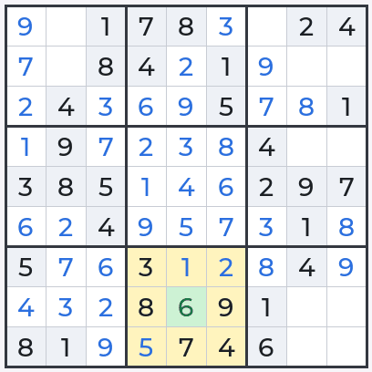

<!-- Written by tools/walkthrough.py anti-king: edit the script, not this page. -->
# Anti-King, step 38: the 6 in box 8

**Step 38 of 49** · [← Step 37](step-37.md) · [All steps](../anti-king.md#the-whole-puzzle-step-by-step) · [Step 39 →](step-39.md)

Box 8 needs a 6, and r8c5 is its last empty cell: **r8c5 = 6**.

**Step 38 of 49** · [← Step 37](step-37.md) · [All steps](../anti-king.md#the-whole-puzzle-step-by-step) · [Step 39 →](step-39.md)
