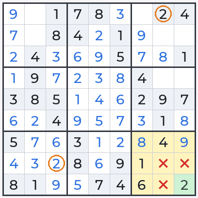

<!-- Written by tools/walkthrough.py anti-king: edit the script, not this page. -->
# Anti-King, step 39: the 2 in box 9

**Step 39 of 49** · [← Step 38](step-38.md) · [All steps](../anti-king.md#the-whole-puzzle-step-by-step) · [Step 40 →](step-40.md)

Box 9 needs a 2. r8c8 and r8c9: row 8 has one (r8c3). r9c8: column 8 has one (r1c8). Only **r9c9** is left: **r9c9 = 2**.

**Step 39 of 49** · [← Step 38](step-38.md) · [All steps](../anti-king.md#the-whole-puzzle-step-by-step) · [Step 40 →](step-40.md)
