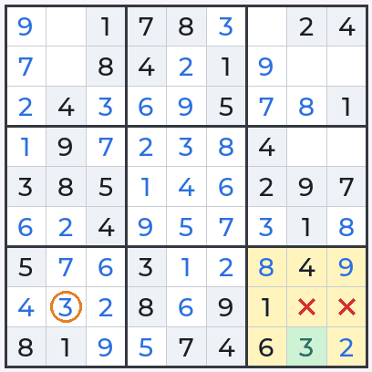

<!-- Written by tools/walkthrough.py anti-king: edit the script, not this page. -->
# Anti-King, step 40: the 3 in box 9

**Step 40 of 49** · [← Step 39](step-39.md) · [All steps](../anti-king.md#the-whole-puzzle-step-by-step) · [Step 41 →](step-41.md)

Box 9 needs a 3. r8c8 and r8c9: row 8 has one (r8c2). Only **r9c8** is left: **r9c8 = 3**.

**Step 40 of 49** · [← Step 39](step-39.md) · [All steps](../anti-king.md#the-whole-puzzle-step-by-step) · [Step 41 →](step-41.md)
