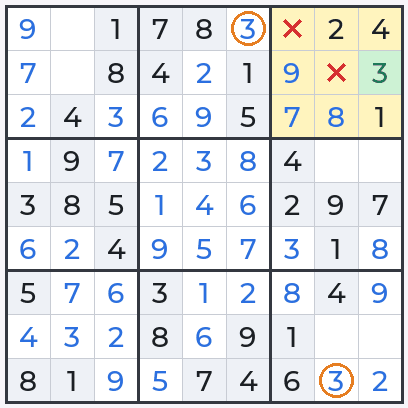

<!-- Written by tools/walkthrough.py anti-king: edit the script, not this page. -->
# Anti-King, step 41: the 3 in box 3

**Step 41 of 49** · [← Step 40](step-40.md) · [All steps](../anti-king.md#the-whole-puzzle-step-by-step) · [Step 42 →](step-42.md)

Box 3 needs a 3. r1c7: row 1 has one (r1c6). r2c8: column 8 has one (r9c8). Only **r2c9** is left: **r2c9 = 3**.

**Step 41 of 49** · [← Step 40](step-40.md) · [All steps](../anti-king.md#the-whole-puzzle-step-by-step) · [Step 42 →](step-42.md)
