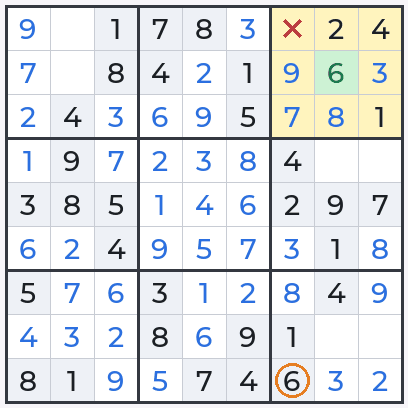

<!-- Written by tools/walkthrough.py anti-king: edit the script, not this page. -->
# Anti-King, step 42: the 6 in box 3

**Step 42 of 49** · [← Step 41](step-41.md) · [All steps](../anti-king.md#the-whole-puzzle-step-by-step) · [Step 43 →](step-43.md)

Box 3 needs a 6. r1c7: column 7 has one (r9c7). Only **r2c8** is left: **r2c8 = 6**.

**Step 42 of 49** · [← Step 41](step-41.md) · [All steps](../anti-king.md#the-whole-puzzle-step-by-step) · [Step 43 →](step-43.md)
