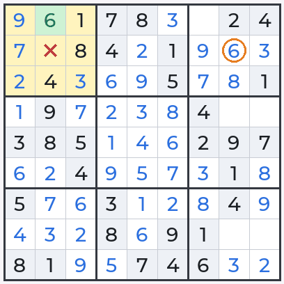

<!-- Written by tools/walkthrough.py anti-king: edit the script, not this page. -->
# Anti-King, step 43: the 6 in box 1

**Step 43 of 49** · [← Step 42](step-42.md) · [All steps](../anti-king.md#the-whole-puzzle-step-by-step) · [Step 44 →](step-44.md)

Box 1 needs a 6. r2c2: row 2 has one (r2c8). Only **r1c2** is left: **r1c2 = 6**.

**Step 43 of 49** · [← Step 42](step-42.md) · [All steps](../anti-king.md#the-whole-puzzle-step-by-step) · [Step 44 →](step-44.md)
