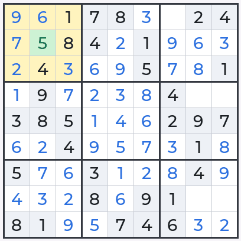

<!-- Written by tools/walkthrough.py anti-king: edit the script, not this page. -->
# Anti-King, step 44: the 5 in box 1

**Step 44 of 49** · [← Step 43](step-43.md) · [All steps](../anti-king.md#the-whole-puzzle-step-by-step) · [Step 45 →](step-45.md)

Box 1 needs a 5, and r2c2 is its last empty cell: **r2c2 = 5**.

**Step 44 of 49** · [← Step 43](step-43.md) · [All steps](../anti-king.md#the-whole-puzzle-step-by-step) · [Step 45 →](step-45.md)
