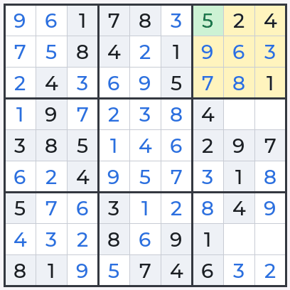

<!-- Written by tools/walkthrough.py anti-king: edit the script, not this page. -->
# Anti-King, step 45: the 5 in box 3

**Step 45 of 49** · [← Step 44](step-44.md) · [All steps](../anti-king.md#the-whole-puzzle-step-by-step) · [Step 46 →](step-46.md)

Box 3 needs a 5, and r1c7 is its last empty cell: **r1c7 = 5**.

**Step 45 of 49** · [← Step 44](step-44.md) · [All steps](../anti-king.md#the-whole-puzzle-step-by-step) · [Step 46 →](step-46.md)
