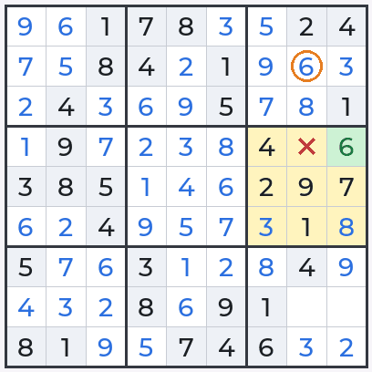

<!-- Written by tools/walkthrough.py anti-king: edit the script, not this page. -->
# Anti-King, step 46: the 6 in box 6

**Step 46 of 49** · [← Step 45](step-45.md) · [All steps](../anti-king.md#the-whole-puzzle-step-by-step) · [Step 47 →](step-47.md)

Box 6 needs a 6. r4c8: column 8 has one (r2c8). Only **r4c9** is left: **r4c9 = 6**.

**Step 46 of 49** · [← Step 45](step-45.md) · [All steps](../anti-king.md#the-whole-puzzle-step-by-step) · [Step 47 →](step-47.md)
