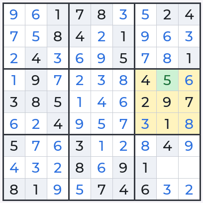

<!-- Written by tools/walkthrough.py anti-king: edit the script, not this page. -->
# Anti-King, step 47: the 5 in box 6

**Step 47 of 49** · [← Step 46](step-46.md) · [All steps](../anti-king.md#the-whole-puzzle-step-by-step) · [Step 48 →](step-48.md)

Box 6 needs a 5, and r4c8 is its last empty cell: **r4c8 = 5**.

**Step 47 of 49** · [← Step 46](step-46.md) · [All steps](../anti-king.md#the-whole-puzzle-step-by-step) · [Step 48 →](step-48.md)
