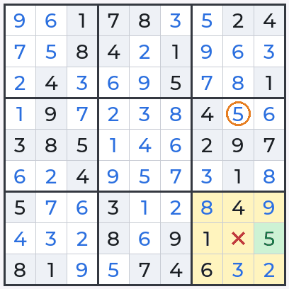

<!-- Written by tools/walkthrough.py anti-king: edit the script, not this page. -->
# Anti-King, step 48: the 5 in box 9

**Step 48 of 49** · [← Step 47](step-47.md) · [All steps](../anti-king.md#the-whole-puzzle-step-by-step) · [Step 49 →](step-49.md)

Box 9 needs a 5. r8c8: column 8 has one (r4c8). Only **r8c9** is left: **r8c9 = 5**.

**Step 48 of 49** · [← Step 47](step-47.md) · [All steps](../anti-king.md#the-whole-puzzle-step-by-step) · [Step 49 →](step-49.md)
