# Anti-Knight

[← All variants](README.md) · [Puzzles](../features-puzzles.md) · [How to play](../how-to-play.md)

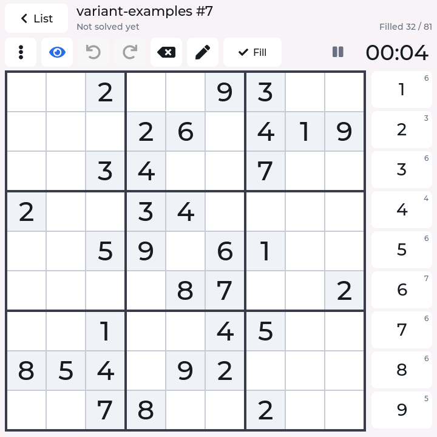

## The rules

[Classic](classic.md) rules, and two cells a **chess knight's move** apart never hold the same digit. A knight's move is two cells in one direction and one cell sideways: from r5c5, the cells r3c4, r3c6, r4c3, r4c7, r6c3, r6c7, r7c4 and r7c6.

## On the board

- Nothing extra is drawn: the rule is the same everywhere.
- A digit that repeats a knight's move away turns red like any other repeat; hints say "a knight's move away".
- The rules card (the ⋮ menu → Rules) draws a 5 with its eight knight cells crossed out.
- **Puzzles → ⋮ → New puzzle → Anti-Knight**.

## How to solve it

- Every cell has up to 8 extra neighbours, so naked singles come much sooner than in Classic: when you check a cell, also look at the eight knight cells around it.
- For a hidden single in a row or box, a digit rules out the cells a knight's move from it, often in the next box over.
- A digit in a 3×3 box rules out a lot of the neighbouring boxes: a 5 in the centre of box 5 sees the edges of boxes 2, 4, 6 and 8.

## Worked example

**variant-examples #7**, Anti-Knight Easy (see [Classic](classic.md#worked-example) for how to import the examples; cells are written r*row*c*column*).

```
. . 2 | . . 9 | 3 . .
. . . | 2 6 . | 4 1 9
. . 3 | 4 . . | 7 . .
------+-------+------
2 . . | 3 4 . | . . .
. . 5 | 9 . 6 | 1 . .
. . . | . 8 7 | . . 2
------+-------+------
. . 1 | . . 4 | 5 . .
8 5 4 | . 9 2 | . . .
. . 7 | 8 . . | 2 . .
```

**Step 1: r7c4.** Row 7 has 1, 4 and 5; column 4 has 2, 4, 3, 9 and 8; box 8 has 4, 9, 2 and 8. By the Classic rules r7c4 could be 6 or 7. A knight's move from r7c4 (one row up, two columns right) is **r6c6**, which is a 7. **r7c4 = 6**.

**Step 2: the 4 in row 6.** Row 6 has 8, 7 and 2; it needs a 4 among r6c1, r6c2, r6c3, r6c4, r6c7 and r6c8:

- r6c2: **r8c3** is a 4, two rows down and one column right: a knight's move.
- r6c3: column 3 has that 4 (r8c3).
- r6c4: column 4 has a 4 (r3c4).
- r6c7: column 7 has a 4 (r2c7).
- r6c8: **r7c6** is a 4, one row down and two columns left: a knight's move.

Only **r6c1** is left: **r6c1 = 4**. Two of the five cells were ruled out by knights.

**Step 3: the 5 in row 9.** Row 9 has 7, 8 and 2; for its 5:

- r9c1, r9c2: box 7 has a 5 (r8c2).
- r9c6: **r7c7** is a 5, two rows up and one column right: a knight's move.
- r9c8, r9c9: box 9 has that 5 (r7c7).

Only **r9c5** is left: **r9c5 = 5**.

## The whole puzzle, step by step

<!-- walkthrough -->
<!-- Written by tools/walkthrough.py anti-knight: edit the script, not this part. -->

The whole puzzle, from the start to the last cell: 49 steps, each one a single (one place left for a digit, or one digit left for a cell), taken in the order a box's single comes first, so not quite the order of the worked example above. In each picture, the unit the step looks at is tinted yellow (for a cell with one digit left: its row, column and box), the new digit is on green, the digits that rule cells out have an **orange ring**, and the empty cells they rule out a **red cross**. Givens are on grey, digits from earlier steps in blue.

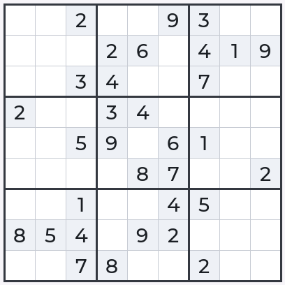

#### Step 1: the 3 in box 2

Box 2 needs a 3. r1c4 and r1c5: row 1 has one (r1c7). r3c5 and r3c6: row 3 has one (r3c3). Only **r2c6** is left: **r2c6 = 3**.

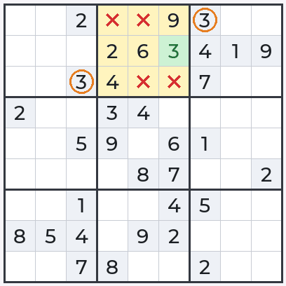

#### Step 2: the 8 in box 2

Box 2 needs an 8. r1c4: column 4 has one (r9c4). r1c5 and r3c5: column 5 has one (r6c5). Only **r3c6** is left: **r3c6 = 8**.

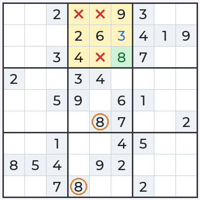

#### Step 3: the 2 in box 3

Box 3 needs a 2. r1c8 and r1c9: row 1 has one (r1c3). r3c9: column 9 has one (r6c9). Only **r3c8** is left: **r3c8 = 2**.

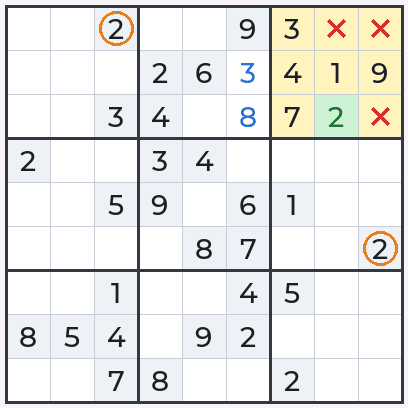

#### Step 4: the 2 in box 5

Box 5 needs a 2. r4c6: row 4 has one (r4c1). r6c4: row 6 has one (r6c9). Only **r5c5** is left: **r5c5 = 2**.

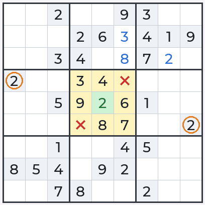

#### Step 5: the 2 in box 7

Box 7 needs a 2. r7c1: column 1 has one (r4c1). r9c1 and r9c2: row 9 has one (r9c7). Only **r7c2** is left: **r7c2 = 2**.

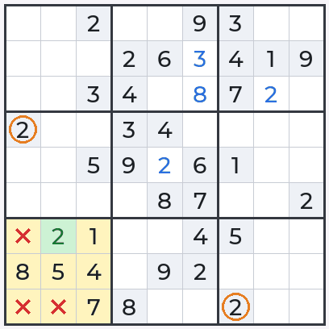

#### Step 6: the 5 in box 8

Box 8 needs a 5. r7c4 and r7c5: row 7 has one (r7c7). r8c4: row 8 has one (r8c2). r9c6: the 5 in r7c7 is a knight's move away. Only **r9c5** is left: **r9c5 = 5**.

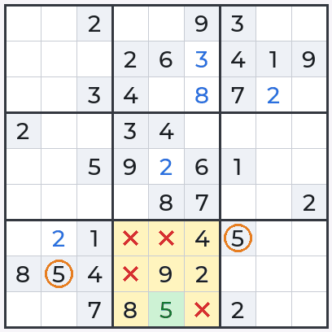

#### Step 7: the 5 in box 2

Box 2 needs a 5. r1c5 and r3c5: column 5 has one (r9c5). Only **r1c4** is left: **r1c4 = 5**.

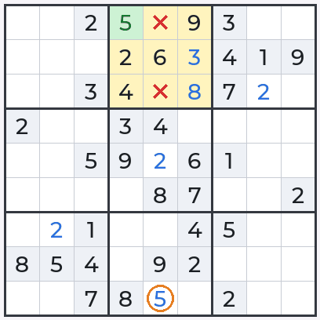

#### Step 8: the 7 in box 2

Box 2 needs a 7. r3c5: row 3 has one (r3c7). Only **r1c5** is left: **r1c5 = 7**.

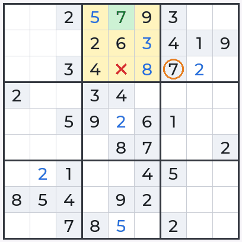

#### Step 9: the 1 in box 2

Box 2 needs a 1, and r3c5 is its last empty cell: **r3c5 = 1**.

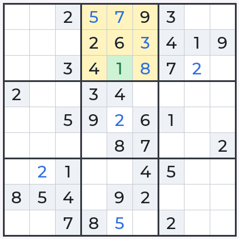

#### Step 10: the 5 in box 3

Box 3 needs a 5. r1c8 and r1c9: row 1 has one (r1c4). Only **r3c9** is left: **r3c9 = 5**.

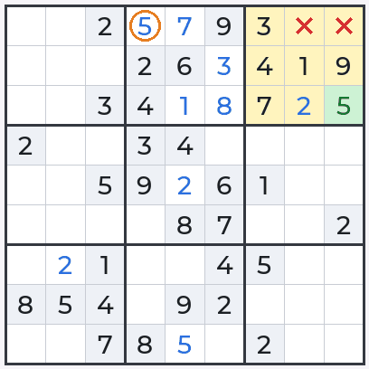

#### Step 11: the 5 in box 1

Box 1 needs a 5. r1c1 and r1c2: row 1 has one (r1c4). r2c2: column 2 has one (r8c2). r2c3: column 3 has one (r5c3). r3c1 and r3c2: row 3 has one (r3c9). Only **r2c1** is left: **r2c1 = 5**.

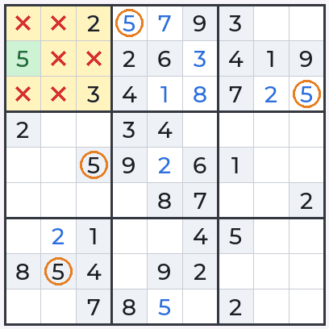

#### Step 12: the 7 in box 1

Box 1 needs a 7. r1c1 and r1c2: row 1 has one (r1c5). r2c3: column 3 has one (r9c3). r3c1 and r3c2: row 3 has one (r3c7). Only **r2c2** is left: **r2c2 = 7**.

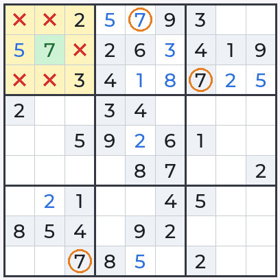

#### Step 13: the 7 in box 4

Box 4 needs a 7. r4c2 and r5c2: column 2 has one (r2c2). r4c3: column 3 has one (r9c3). r6c1, r6c2 and r6c3: row 6 has one (r6c6). Only **r5c1** is left: **r5c1 = 7**.

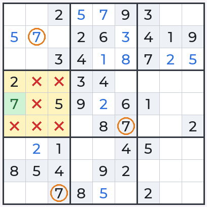

#### Step 14: the 5 in box 5

Box 5 needs a 5. r6c4: column 4 has one (r1c4). Only **r4c6** is left: **r4c6 = 5**.

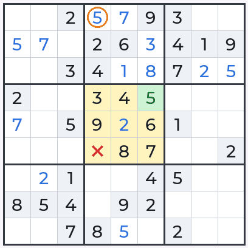

#### Step 15: the 1 in box 5

Box 5 needs a 1, and r6c4 is its last empty cell: **r6c4 = 1**.

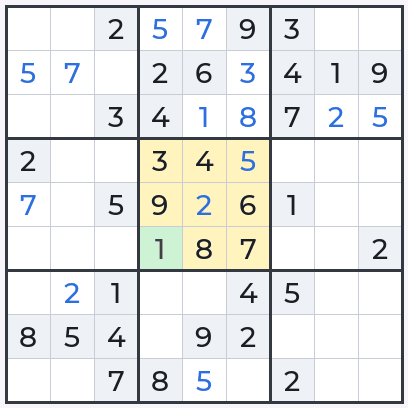

#### Step 16: the 1 in box 4

Box 4 needs a 1. r4c3: column 3 has one (r7c3). r5c2: row 5 has one (r5c7). r6c1, r6c2 and r6c3: row 6 has one (r6c4). Only **r4c2** is left: **r4c2 = 1**.

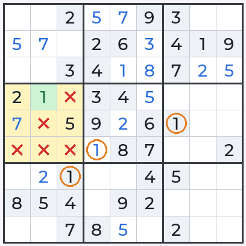

#### Step 17: the 1 in box 1

Box 1 needs a 1. r1c2: column 2 has one (r4c2). r2c3: row 2 has one (r2c8). r3c1 and r3c2: row 3 has one (r3c5). Only **r1c1** is left: **r1c1 = 1**.

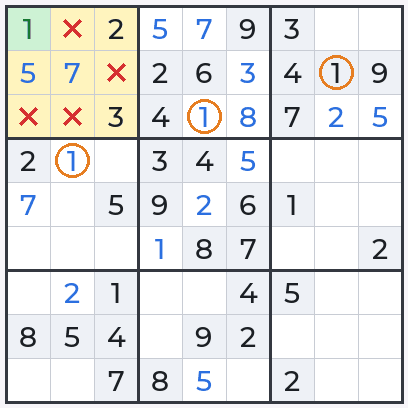

#### Step 18: the 4 in box 1

Box 1 needs a 4. r2c3: row 2 has one (r2c7). r3c1 and r3c2: row 3 has one (r3c4). Only **r1c2** is left: **r1c2 = 4**.

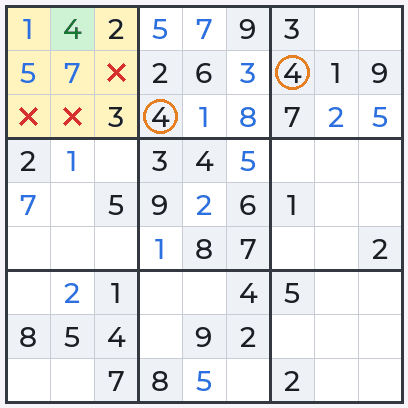

#### Step 19: the 8 in box 1

Box 1 needs an 8. r3c1 and r3c2: row 3 has one (r3c6). Only **r2c3** is left: **r2c3 = 8**.

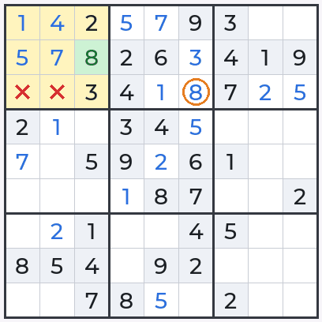

#### Step 20: the 4 in box 4

Box 4 needs a 4. r4c3: row 4 has one (r4c5). r5c2 and r6c2: column 2 has one (r1c2). r6c3: column 3 has one (r8c3). Only **r6c1** is left: **r6c1 = 4**.

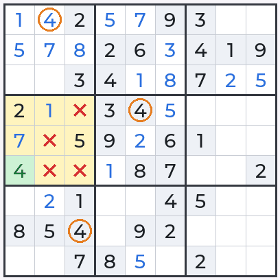

#### Step 21: the 3 in box 4

Box 4 needs a 3. r4c3: row 4 has one (r4c4). r5c2: the 3 in r3c3 is a knight's move away. r6c3: column 3 has one (r3c3). Only **r6c2** is left: **r6c2 = 3**.

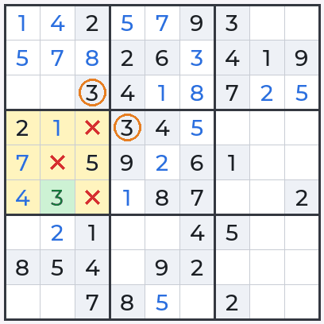

#### Step 22: the 8 in box 4

Box 4 needs an 8. r4c3: column 3 has one (r2c3). r6c3: row 6 has one (r6c5). Only **r5c2** is left: **r5c2 = 8**.

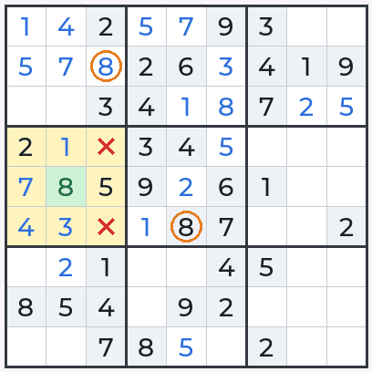

#### Step 23: the 5 in box 6

Box 6 needs a 5. r4c7, r4c8 and r4c9: row 4 has one (r4c6). r5c8 and r5c9: row 5 has one (r5c3). r6c7: column 7 has one (r7c7). Only **r6c8** is left: **r6c8 = 5**.

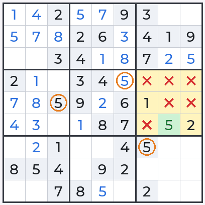

#### Step 24: the 7 in box 6

Box 6 needs a 7. r4c7: column 7 has one (r3c7). r4c9: the 7 in r3c7 is a knight's move away. r5c8 and r5c9: row 5 has one (r5c1). r6c7: row 6 has one (r6c6). Only **r4c8** is left: **r4c8 = 7**.

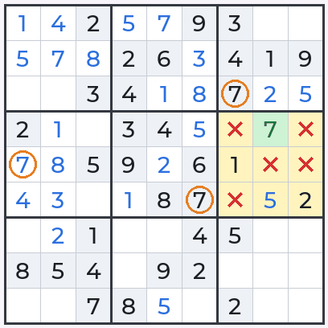

#### Step 25: the 1 in box 8

Box 8 needs a 1. r7c4 and r7c5: row 7 has one (r7c3). r8c4: column 4 has one (r6c4). Only **r9c6** is left: **r9c6 = 1**.

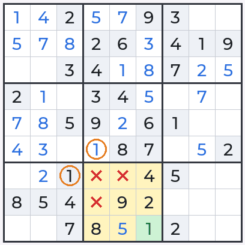

#### Step 26: the 3 in box 8

Box 8 needs a 3. r7c4 and r8c4: column 4 has one (r4c4). Only **r7c5** is left: **r7c5 = 3**.

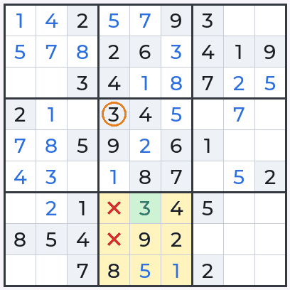

#### Step 27: the 3 in box 7

Box 7 needs a 3. r7c1: row 7 has one (r7c5). r9c2: column 2 has one (r6c2). Only **r9c1** is left: **r9c1 = 3**.

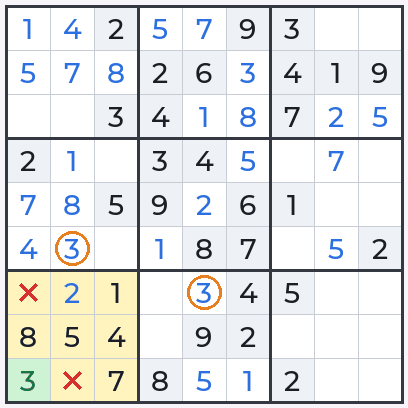

#### Step 28: the 7 in box 8

Box 8 needs a 7. r7c4: the 7 in r6c6 is a knight's move away. Only **r8c4** is left: **r8c4 = 7**.

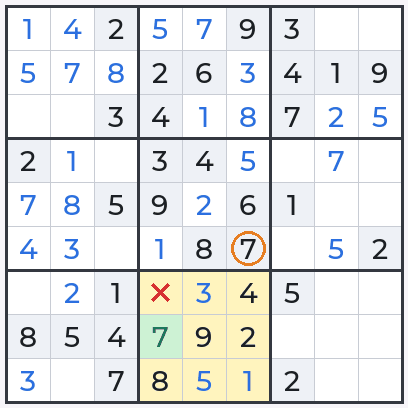

#### Step 29: the 6 in box 8

Box 8 needs a 6, and r7c4 is its last empty cell: **r7c4 = 6**.

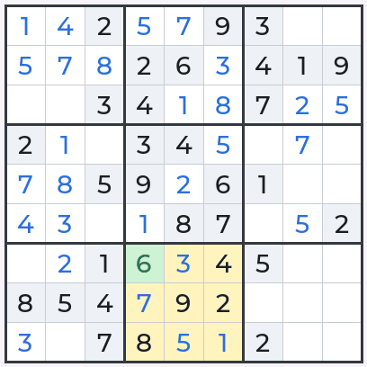

#### Step 30: the 6 in box 7

Box 7 needs a 6. r7c1: row 7 has one (r7c4). Only **r9c2** is left: **r9c2 = 6**.

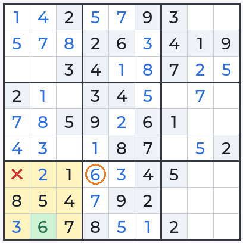

#### Step 31: the 6 in box 1

Box 1 needs a 6. r3c2: column 2 has one (r9c2). Only **r3c1** is left: **r3c1 = 6**.

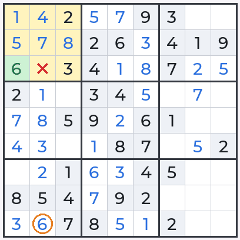

#### Step 32: the 9 in box 1

Box 1 needs a 9, and r3c2 is its last empty cell: **r3c2 = 9**.

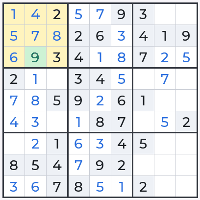

#### Step 33: the 6 in box 4

Box 4 needs a 6. r4c3: the 6 in r3c1 is a knight's move away. Only **r6c3** is left: **r6c3 = 6**.

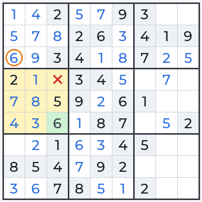

#### Step 34: the 9 in box 4

Box 4 needs a 9, and r4c3 is its last empty cell: **r4c3 = 9**.

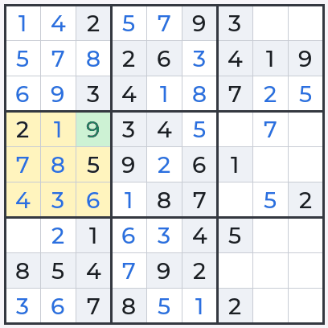

#### Step 35: the 9 in box 6

Box 6 needs a 9. r4c7 and r4c9: row 4 has one (r4c3). r5c8 and r5c9: row 5 has one (r5c4). Only **r6c7** is left: **r6c7 = 9**.

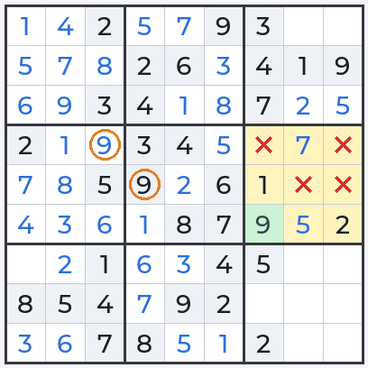

#### Step 36: the 9 in box 7

Box 7 needs a 9, and r7c1 is its last empty cell: **r7c1 = 9**.

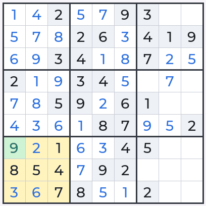

#### Step 37: the 1 in box 9

Box 9 needs a 1. r7c8 and r7c9: row 7 has one (r7c3). r8c7: column 7 has one (r5c7). r8c8: column 8 has one (r2c8). r9c8 and r9c9: row 9 has one (r9c6). Only **r8c9** is left: **r8c9 = 1**.

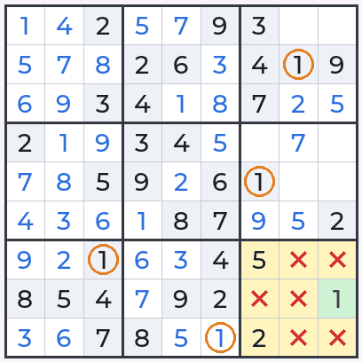

#### Step 38: the 3 in box 9

Box 9 needs a 3. r7c8 and r7c9: row 7 has one (r7c5). r8c7: column 7 has one (r1c7). r9c8 and r9c9: row 9 has one (r9c1). Only **r8c8** is left: **r8c8 = 3**.

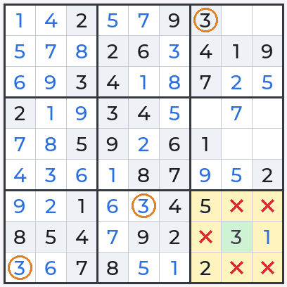

#### Step 39: the 3 in box 6

Box 6 needs a 3. r4c7 and r4c9: row 4 has one (r4c4). r5c8: column 8 has one (r8c8). Only **r5c9** is left: **r5c9 = 3**.

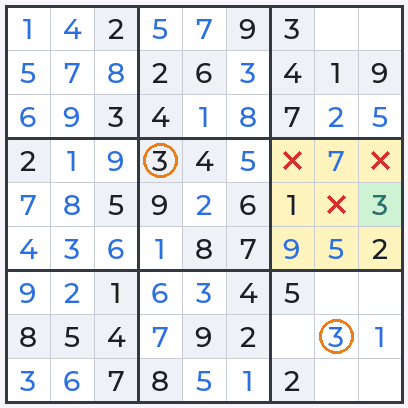

#### Step 40: the 4 in box 6

Box 6 needs a 4. r4c7 and r4c9: row 4 has one (r4c5). Only **r5c8** is left: **r5c8 = 4**.

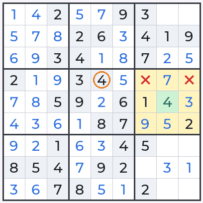

#### Step 41: the 4 in box 9

Box 9 needs a 4. r7c8 and r7c9: row 7 has one (r7c6). r8c7: row 8 has one (r8c3). r9c8: column 8 has one (r5c8). Only **r9c9** is left: **r9c9 = 4**.

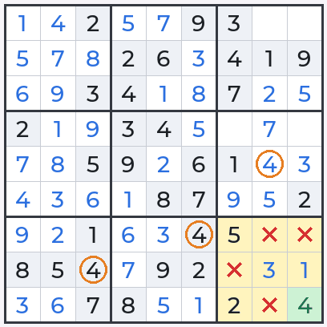

#### Step 42: the 6 in box 9

Box 9 needs a 6. r7c8 and r7c9: row 7 has one (r7c4). r9c8: row 9 has one (r9c2). Only **r8c7** is left: **r8c7 = 6**.

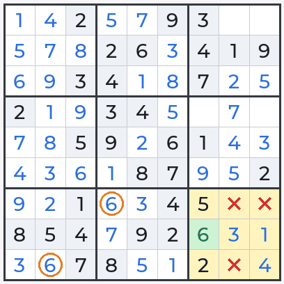

#### Step 43: the 6 in box 6

Box 6 needs a 6. r4c7: column 7 has one (r8c7). Only **r4c9** is left: **r4c9 = 6**.

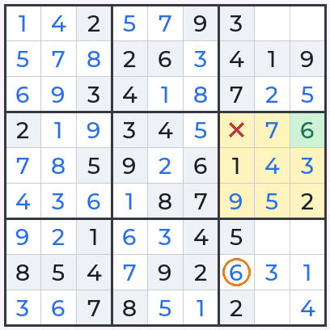

#### Step 44: the 6 in box 3

Box 3 needs a 6. r1c9: column 9 has one (r4c9). Only **r1c8** is left: **r1c8 = 6**.

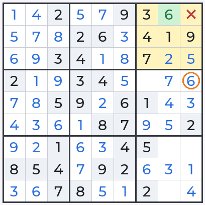

#### Step 45: the 8 in box 3

Box 3 needs an 8, and r1c9 is its last empty cell: **r1c9 = 8**.

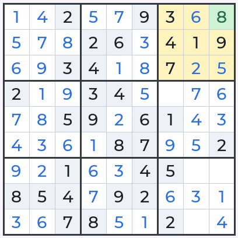

#### Step 46: the 8 in box 6

Box 6 needs an 8, and r4c7 is its last empty cell: **r4c7 = 8**.

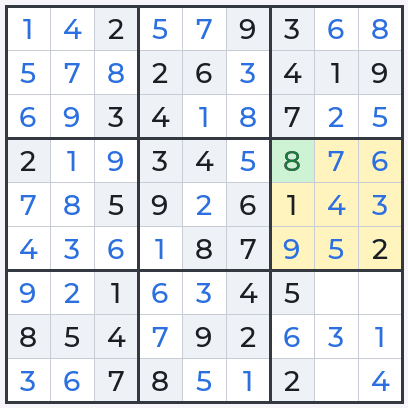

#### Step 47: the 7 in box 9

Box 9 needs a 7. r7c8: column 8 has one (r4c8). r9c8: row 9 has one (r9c3). Only **r7c9** is left: **r7c9 = 7**.

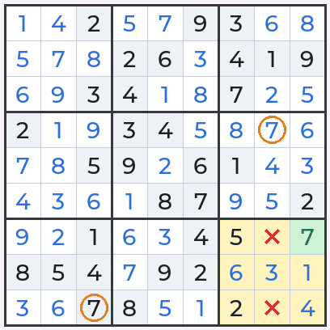

#### Step 48: the 8 in box 9

Box 9 needs an 8. r9c8: row 9 has one (r9c4). Only **r7c8** is left: **r7c8 = 8**.

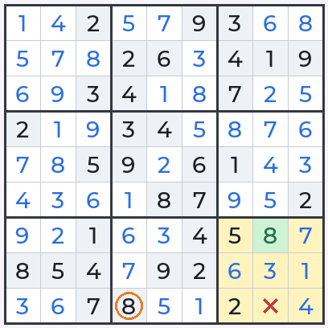

#### Step 49: the 9 in box 9

Box 9 needs a 9, and r9c8 is its last empty cell: **r9c8 = 9**.


Solved.

<!-- /walkthrough -->
