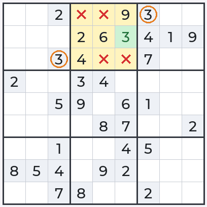

<!-- Written by tools/walkthrough.py anti-knight: edit the script, not this page. -->
# Anti-Knight, step 1: the 3 in box 2

**Step 1 of 49** · [← The start](../anti-knight.md#the-whole-puzzle-step-by-step) · [All steps](../anti-knight.md#the-whole-puzzle-step-by-step) · [Step 2 →](step-02.md)

Box 2 needs a 3. r1c4 and r1c5: row 1 has one (r1c7). r3c5 and r3c6: row 3 has one (r3c3). Only **r2c6** is left: **r2c6 = 3**.

**Step 1 of 49** · [← The start](../anti-knight.md#the-whole-puzzle-step-by-step) · [All steps](../anti-knight.md#the-whole-puzzle-step-by-step) · [Step 2 →](step-02.md)
