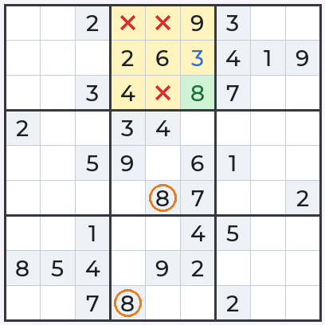

<!-- Written by tools/walkthrough.py anti-knight: edit the script, not this page. -->
# Anti-Knight, step 2: the 8 in box 2

**Step 2 of 49** · [← Step 1](step-01.md) · [All steps](../anti-knight.md#the-whole-puzzle-step-by-step) · [Step 3 →](step-03.md)

Box 2 needs an 8. r1c4: column 4 has one (r9c4). r1c5 and r3c5: column 5 has one (r6c5). Only **r3c6** is left: **r3c6 = 8**.

**Step 2 of 49** · [← Step 1](step-01.md) · [All steps](../anti-knight.md#the-whole-puzzle-step-by-step) · [Step 3 →](step-03.md)
