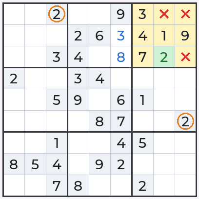

<!-- Written by tools/walkthrough.py anti-knight: edit the script, not this page. -->
# Anti-Knight, step 3: the 2 in box 3

**Step 3 of 49** · [← Step 2](step-02.md) · [All steps](../anti-knight.md#the-whole-puzzle-step-by-step) · [Step 4 →](step-04.md)

Box 3 needs a 2. r1c8 and r1c9: row 1 has one (r1c3). r3c9: column 9 has one (r6c9). Only **r3c8** is left: **r3c8 = 2**.

**Step 3 of 49** · [← Step 2](step-02.md) · [All steps](../anti-knight.md#the-whole-puzzle-step-by-step) · [Step 4 →](step-04.md)
