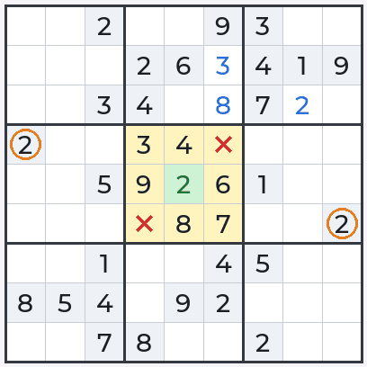

<!-- Written by tools/walkthrough.py anti-knight: edit the script, not this page. -->
# Anti-Knight, step 4: the 2 in box 5

**Step 4 of 49** · [← Step 3](step-03.md) · [All steps](../anti-knight.md#the-whole-puzzle-step-by-step) · [Step 5 →](step-05.md)

Box 5 needs a 2. r4c6: row 4 has one (r4c1). r6c4: row 6 has one (r6c9). Only **r5c5** is left: **r5c5 = 2**.

**Step 4 of 49** · [← Step 3](step-03.md) · [All steps](../anti-knight.md#the-whole-puzzle-step-by-step) · [Step 5 →](step-05.md)
