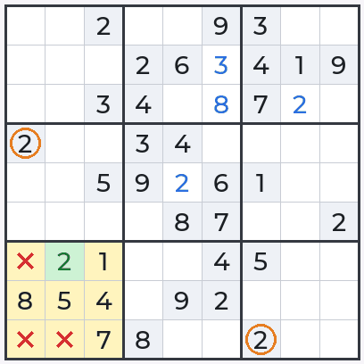

<!-- Written by tools/walkthrough.py anti-knight: edit the script, not this page. -->
# Anti-Knight, step 5: the 2 in box 7

**Step 5 of 49** · [← Step 4](step-04.md) · [All steps](../anti-knight.md#the-whole-puzzle-step-by-step) · [Step 6 →](step-06.md)

Box 7 needs a 2. r7c1: column 1 has one (r4c1). r9c1 and r9c2: row 9 has one (r9c7). Only **r7c2** is left: **r7c2 = 2**.

**Step 5 of 49** · [← Step 4](step-04.md) · [All steps](../anti-knight.md#the-whole-puzzle-step-by-step) · [Step 6 →](step-06.md)
