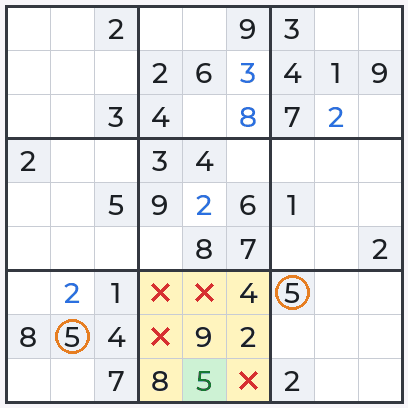

<!-- Written by tools/walkthrough.py anti-knight: edit the script, not this page. -->
# Anti-Knight, step 6: the 5 in box 8

**Step 6 of 49** · [← Step 5](step-05.md) · [All steps](../anti-knight.md#the-whole-puzzle-step-by-step) · [Step 7 →](step-07.md)

Box 8 needs a 5. r7c4 and r7c5: row 7 has one (r7c7). r8c4: row 8 has one (r8c2). r9c6: the 5 in r7c7 is a knight's move away. Only **r9c5** is left: **r9c5 = 5**.

**Step 6 of 49** · [← Step 5](step-05.md) · [All steps](../anti-knight.md#the-whole-puzzle-step-by-step) · [Step 7 →](step-07.md)
