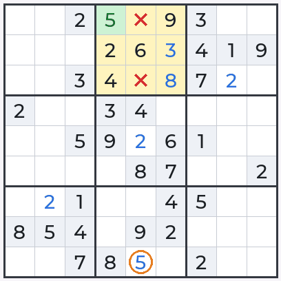

<!-- Written by tools/walkthrough.py anti-knight: edit the script, not this page. -->
# Anti-Knight, step 7: the 5 in box 2

**Step 7 of 49** · [← Step 6](step-06.md) · [All steps](../anti-knight.md#the-whole-puzzle-step-by-step) · [Step 8 →](step-08.md)

Box 2 needs a 5. r1c5 and r3c5: column 5 has one (r9c5). Only **r1c4** is left: **r1c4 = 5**.

**Step 7 of 49** · [← Step 6](step-06.md) · [All steps](../anti-knight.md#the-whole-puzzle-step-by-step) · [Step 8 →](step-08.md)
