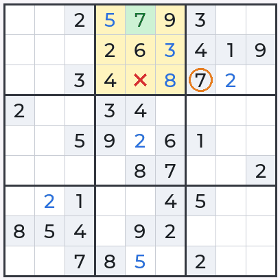

<!-- Written by tools/walkthrough.py anti-knight: edit the script, not this page. -->
# Anti-Knight, step 8: the 7 in box 2

**Step 8 of 49** · [← Step 7](step-07.md) · [All steps](../anti-knight.md#the-whole-puzzle-step-by-step) · [Step 9 →](step-09.md)

Box 2 needs a 7. r3c5: row 3 has one (r3c7). Only **r1c5** is left: **r1c5 = 7**.

**Step 8 of 49** · [← Step 7](step-07.md) · [All steps](../anti-knight.md#the-whole-puzzle-step-by-step) · [Step 9 →](step-09.md)
