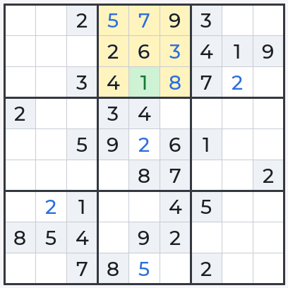

<!-- Written by tools/walkthrough.py anti-knight: edit the script, not this page. -->
# Anti-Knight, step 9: the 1 in box 2

**Step 9 of 49** · [← Step 8](step-08.md) · [All steps](../anti-knight.md#the-whole-puzzle-step-by-step) · [Step 10 →](step-10.md)

Box 2 needs a 1, and r3c5 is its last empty cell: **r3c5 = 1**.

**Step 9 of 49** · [← Step 8](step-08.md) · [All steps](../anti-knight.md#the-whole-puzzle-step-by-step) · [Step 10 →](step-10.md)
