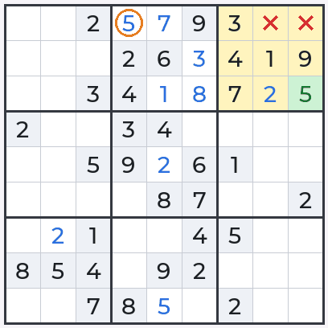

<!-- Written by tools/walkthrough.py anti-knight: edit the script, not this page. -->
# Anti-Knight, step 10: the 5 in box 3

**Step 10 of 49** · [← Step 9](step-09.md) · [All steps](../anti-knight.md#the-whole-puzzle-step-by-step) · [Step 11 →](step-11.md)

Box 3 needs a 5. r1c8 and r1c9: row 1 has one (r1c4). Only **r3c9** is left: **r3c9 = 5**.

**Step 10 of 49** · [← Step 9](step-09.md) · [All steps](../anti-knight.md#the-whole-puzzle-step-by-step) · [Step 11 →](step-11.md)
