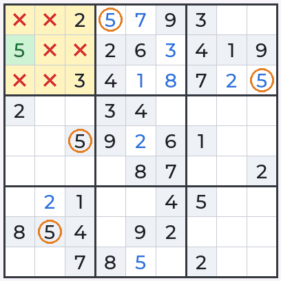

<!-- Written by tools/walkthrough.py anti-knight: edit the script, not this page. -->
# Anti-Knight, step 11: the 5 in box 1

**Step 11 of 49** · [← Step 10](step-10.md) · [All steps](../anti-knight.md#the-whole-puzzle-step-by-step) · [Step 12 →](step-12.md)

Box 1 needs a 5. r1c1 and r1c2: row 1 has one (r1c4). r2c2: column 2 has one (r8c2). r2c3: column 3 has one (r5c3). r3c1 and r3c2: row 3 has one (r3c9). Only **r2c1** is left: **r2c1 = 5**.

**Step 11 of 49** · [← Step 10](step-10.md) · [All steps](../anti-knight.md#the-whole-puzzle-step-by-step) · [Step 12 →](step-12.md)
