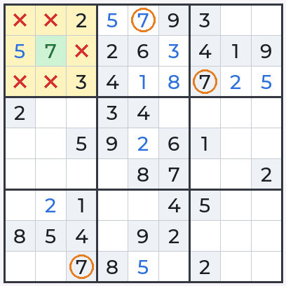

<!-- Written by tools/walkthrough.py anti-knight: edit the script, not this page. -->
# Anti-Knight, step 12: the 7 in box 1

**Step 12 of 49** · [← Step 11](step-11.md) · [All steps](../anti-knight.md#the-whole-puzzle-step-by-step) · [Step 13 →](step-13.md)

Box 1 needs a 7. r1c1 and r1c2: row 1 has one (r1c5). r2c3: column 3 has one (r9c3). r3c1 and r3c2: row 3 has one (r3c7). Only **r2c2** is left: **r2c2 = 7**.

**Step 12 of 49** · [← Step 11](step-11.md) · [All steps](../anti-knight.md#the-whole-puzzle-step-by-step) · [Step 13 →](step-13.md)
