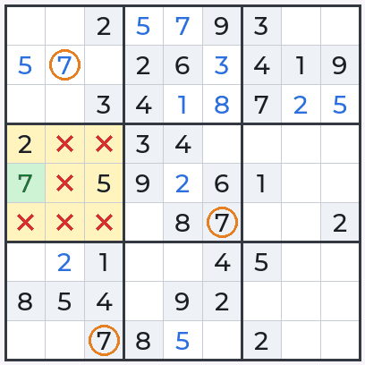

<!-- Written by tools/walkthrough.py anti-knight: edit the script, not this page. -->
# Anti-Knight, step 13: the 7 in box 4

**Step 13 of 49** · [← Step 12](step-12.md) · [All steps](../anti-knight.md#the-whole-puzzle-step-by-step) · [Step 14 →](step-14.md)

Box 4 needs a 7. r4c2 and r5c2: column 2 has one (r2c2). r4c3: column 3 has one (r9c3). r6c1, r6c2 and r6c3: row 6 has one (r6c6). Only **r5c1** is left: **r5c1 = 7**.

**Step 13 of 49** · [← Step 12](step-12.md) · [All steps](../anti-knight.md#the-whole-puzzle-step-by-step) · [Step 14 →](step-14.md)
