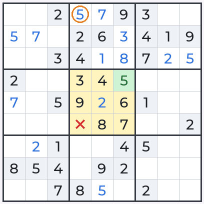

<!-- Written by tools/walkthrough.py anti-knight: edit the script, not this page. -->
# Anti-Knight, step 14: the 5 in box 5

**Step 14 of 49** · [← Step 13](step-13.md) · [All steps](../anti-knight.md#the-whole-puzzle-step-by-step) · [Step 15 →](step-15.md)

Box 5 needs a 5. r6c4: column 4 has one (r1c4). Only **r4c6** is left: **r4c6 = 5**.

**Step 14 of 49** · [← Step 13](step-13.md) · [All steps](../anti-knight.md#the-whole-puzzle-step-by-step) · [Step 15 →](step-15.md)
