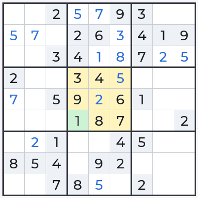

<!-- Written by tools/walkthrough.py anti-knight: edit the script, not this page. -->
# Anti-Knight, step 15: the 1 in box 5

**Step 15 of 49** · [← Step 14](step-14.md) · [All steps](../anti-knight.md#the-whole-puzzle-step-by-step) · [Step 16 →](step-16.md)

Box 5 needs a 1, and r6c4 is its last empty cell: **r6c4 = 1**.

**Step 15 of 49** · [← Step 14](step-14.md) · [All steps](../anti-knight.md#the-whole-puzzle-step-by-step) · [Step 16 →](step-16.md)
