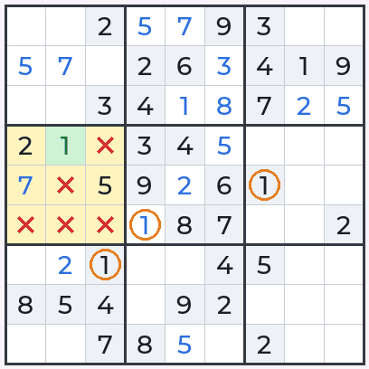

<!-- Written by tools/walkthrough.py anti-knight: edit the script, not this page. -->
# Anti-Knight, step 16: the 1 in box 4

**Step 16 of 49** · [← Step 15](step-15.md) · [All steps](../anti-knight.md#the-whole-puzzle-step-by-step) · [Step 17 →](step-17.md)

Box 4 needs a 1. r4c3: column 3 has one (r7c3). r5c2: row 5 has one (r5c7). r6c1, r6c2 and r6c3: row 6 has one (r6c4). Only **r4c2** is left: **r4c2 = 1**.

**Step 16 of 49** · [← Step 15](step-15.md) · [All steps](../anti-knight.md#the-whole-puzzle-step-by-step) · [Step 17 →](step-17.md)
