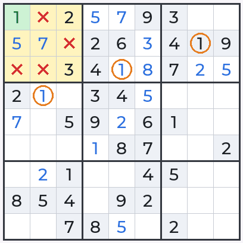

<!-- Written by tools/walkthrough.py anti-knight: edit the script, not this page. -->
# Anti-Knight, step 17: the 1 in box 1

**Step 17 of 49** · [← Step 16](step-16.md) · [All steps](../anti-knight.md#the-whole-puzzle-step-by-step) · [Step 18 →](step-18.md)

Box 1 needs a 1. r1c2: column 2 has one (r4c2). r2c3: row 2 has one (r2c8). r3c1 and r3c2: row 3 has one (r3c5). Only **r1c1** is left: **r1c1 = 1**.

**Step 17 of 49** · [← Step 16](step-16.md) · [All steps](../anti-knight.md#the-whole-puzzle-step-by-step) · [Step 18 →](step-18.md)
