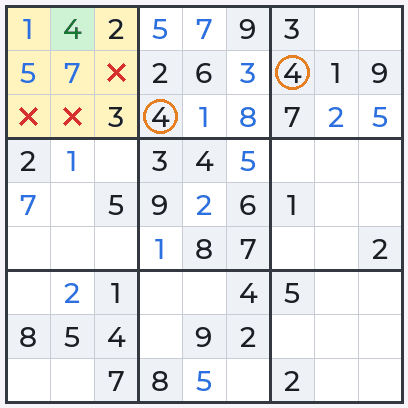

<!-- Written by tools/walkthrough.py anti-knight: edit the script, not this page. -->
# Anti-Knight, step 18: the 4 in box 1

**Step 18 of 49** · [← Step 17](step-17.md) · [All steps](../anti-knight.md#the-whole-puzzle-step-by-step) · [Step 19 →](step-19.md)

Box 1 needs a 4. r2c3: row 2 has one (r2c7). r3c1 and r3c2: row 3 has one (r3c4). Only **r1c2** is left: **r1c2 = 4**.

**Step 18 of 49** · [← Step 17](step-17.md) · [All steps](../anti-knight.md#the-whole-puzzle-step-by-step) · [Step 19 →](step-19.md)
