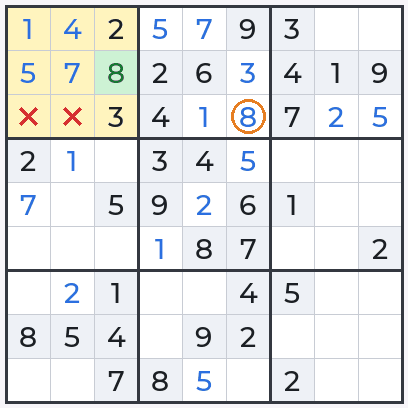

<!-- Written by tools/walkthrough.py anti-knight: edit the script, not this page. -->
# Anti-Knight, step 19: the 8 in box 1

**Step 19 of 49** · [← Step 18](step-18.md) · [All steps](../anti-knight.md#the-whole-puzzle-step-by-step) · [Step 20 →](step-20.md)

Box 1 needs an 8. r3c1 and r3c2: row 3 has one (r3c6). Only **r2c3** is left: **r2c3 = 8**.

**Step 19 of 49** · [← Step 18](step-18.md) · [All steps](../anti-knight.md#the-whole-puzzle-step-by-step) · [Step 20 →](step-20.md)
