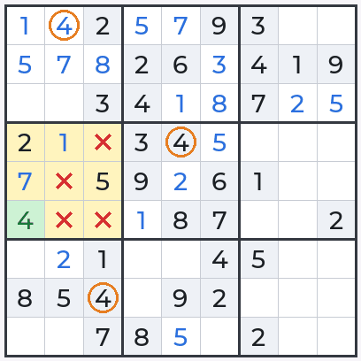

<!-- Written by tools/walkthrough.py anti-knight: edit the script, not this page. -->
# Anti-Knight, step 20: the 4 in box 4

**Step 20 of 49** · [← Step 19](step-19.md) · [All steps](../anti-knight.md#the-whole-puzzle-step-by-step) · [Step 21 →](step-21.md)

Box 4 needs a 4. r4c3: row 4 has one (r4c5). r5c2 and r6c2: column 2 has one (r1c2). r6c3: column 3 has one (r8c3). Only **r6c1** is left: **r6c1 = 4**.

**Step 20 of 49** · [← Step 19](step-19.md) · [All steps](../anti-knight.md#the-whole-puzzle-step-by-step) · [Step 21 →](step-21.md)
