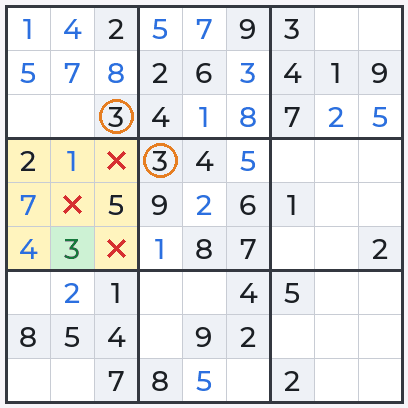

<!-- Written by tools/walkthrough.py anti-knight: edit the script, not this page. -->
# Anti-Knight, step 21: the 3 in box 4

**Step 21 of 49** · [← Step 20](step-20.md) · [All steps](../anti-knight.md#the-whole-puzzle-step-by-step) · [Step 22 →](step-22.md)

Box 4 needs a 3. r4c3: row 4 has one (r4c4). r5c2: the 3 in r3c3 is a knight's move away. r6c3: column 3 has one (r3c3). Only **r6c2** is left: **r6c2 = 3**.

**Step 21 of 49** · [← Step 20](step-20.md) · [All steps](../anti-knight.md#the-whole-puzzle-step-by-step) · [Step 22 →](step-22.md)
