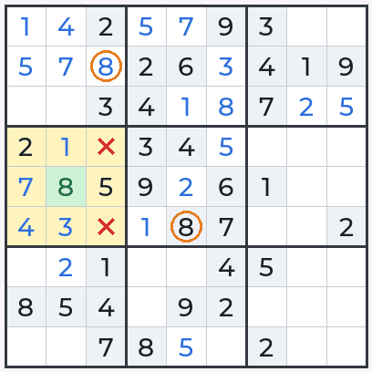

<!-- Written by tools/walkthrough.py anti-knight: edit the script, not this page. -->
# Anti-Knight, step 22: the 8 in box 4

**Step 22 of 49** · [← Step 21](step-21.md) · [All steps](../anti-knight.md#the-whole-puzzle-step-by-step) · [Step 23 →](step-23.md)

Box 4 needs an 8. r4c3: column 3 has one (r2c3). r6c3: row 6 has one (r6c5). Only **r5c2** is left: **r5c2 = 8**.

**Step 22 of 49** · [← Step 21](step-21.md) · [All steps](../anti-knight.md#the-whole-puzzle-step-by-step) · [Step 23 →](step-23.md)
