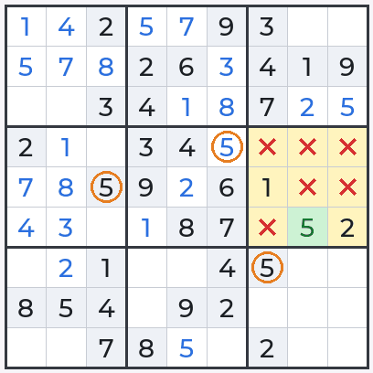

<!-- Written by tools/walkthrough.py anti-knight: edit the script, not this page. -->
# Anti-Knight, step 23: the 5 in box 6

**Step 23 of 49** · [← Step 22](step-22.md) · [All steps](../anti-knight.md#the-whole-puzzle-step-by-step) · [Step 24 →](step-24.md)

Box 6 needs a 5. r4c7, r4c8 and r4c9: row 4 has one (r4c6). r5c8 and r5c9: row 5 has one (r5c3). r6c7: column 7 has one (r7c7). Only **r6c8** is left: **r6c8 = 5**.

**Step 23 of 49** · [← Step 22](step-22.md) · [All steps](../anti-knight.md#the-whole-puzzle-step-by-step) · [Step 24 →](step-24.md)
