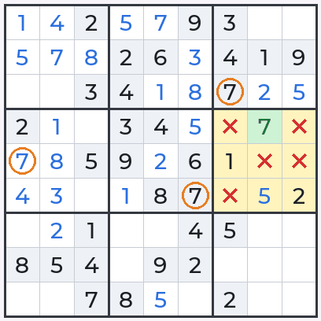

<!-- Written by tools/walkthrough.py anti-knight: edit the script, not this page. -->
# Anti-Knight, step 24: the 7 in box 6

**Step 24 of 49** · [← Step 23](step-23.md) · [All steps](../anti-knight.md#the-whole-puzzle-step-by-step) · [Step 25 →](step-25.md)

Box 6 needs a 7. r4c7: column 7 has one (r3c7). r4c9: the 7 in r3c7 is a knight's move away. r5c8 and r5c9: row 5 has one (r5c1). r6c7: row 6 has one (r6c6). Only **r4c8** is left: **r4c8 = 7**.

**Step 24 of 49** · [← Step 23](step-23.md) · [All steps](../anti-knight.md#the-whole-puzzle-step-by-step) · [Step 25 →](step-25.md)
