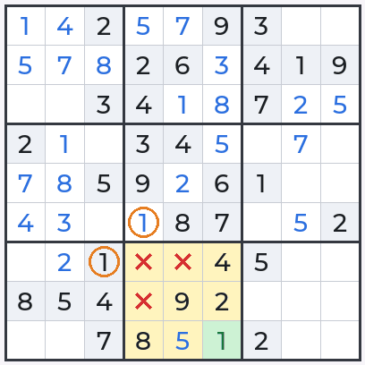

<!-- Written by tools/walkthrough.py anti-knight: edit the script, not this page. -->
# Anti-Knight, step 25: the 1 in box 8

**Step 25 of 49** · [← Step 24](step-24.md) · [All steps](../anti-knight.md#the-whole-puzzle-step-by-step) · [Step 26 →](step-26.md)

Box 8 needs a 1. r7c4 and r7c5: row 7 has one (r7c3). r8c4: column 4 has one (r6c4). Only **r9c6** is left: **r9c6 = 1**.

**Step 25 of 49** · [← Step 24](step-24.md) · [All steps](../anti-knight.md#the-whole-puzzle-step-by-step) · [Step 26 →](step-26.md)
