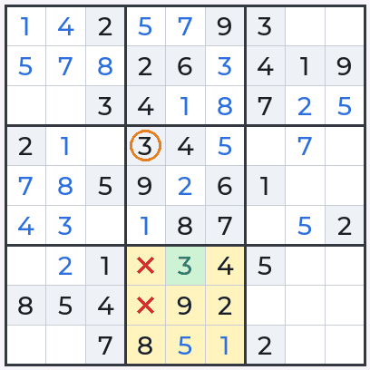

<!-- Written by tools/walkthrough.py anti-knight: edit the script, not this page. -->
# Anti-Knight, step 26: the 3 in box 8

**Step 26 of 49** · [← Step 25](step-25.md) · [All steps](../anti-knight.md#the-whole-puzzle-step-by-step) · [Step 27 →](step-27.md)

Box 8 needs a 3. r7c4 and r8c4: column 4 has one (r4c4). Only **r7c5** is left: **r7c5 = 3**.

**Step 26 of 49** · [← Step 25](step-25.md) · [All steps](../anti-knight.md#the-whole-puzzle-step-by-step) · [Step 27 →](step-27.md)
