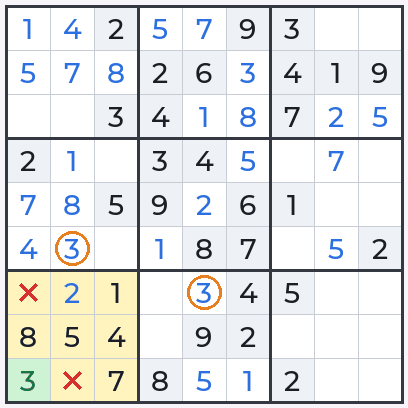

<!-- Written by tools/walkthrough.py anti-knight: edit the script, not this page. -->
# Anti-Knight, step 27: the 3 in box 7

**Step 27 of 49** · [← Step 26](step-26.md) · [All steps](../anti-knight.md#the-whole-puzzle-step-by-step) · [Step 28 →](step-28.md)

Box 7 needs a 3. r7c1: row 7 has one (r7c5). r9c2: column 2 has one (r6c2). Only **r9c1** is left: **r9c1 = 3**.

**Step 27 of 49** · [← Step 26](step-26.md) · [All steps](../anti-knight.md#the-whole-puzzle-step-by-step) · [Step 28 →](step-28.md)
