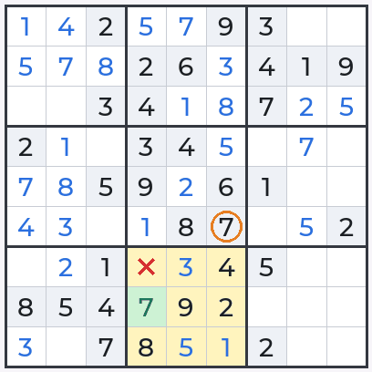

<!-- Written by tools/walkthrough.py anti-knight: edit the script, not this page. -->
# Anti-Knight, step 28: the 7 in box 8

**Step 28 of 49** · [← Step 27](step-27.md) · [All steps](../anti-knight.md#the-whole-puzzle-step-by-step) · [Step 29 →](step-29.md)

Box 8 needs a 7. r7c4: the 7 in r6c6 is a knight's move away. Only **r8c4** is left: **r8c4 = 7**.

**Step 28 of 49** · [← Step 27](step-27.md) · [All steps](../anti-knight.md#the-whole-puzzle-step-by-step) · [Step 29 →](step-29.md)
