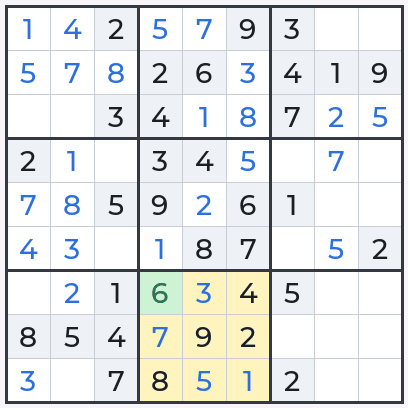

<!-- Written by tools/walkthrough.py anti-knight: edit the script, not this page. -->
# Anti-Knight, step 29: the 6 in box 8

**Step 29 of 49** · [← Step 28](step-28.md) · [All steps](../anti-knight.md#the-whole-puzzle-step-by-step) · [Step 30 →](step-30.md)

Box 8 needs a 6, and r7c4 is its last empty cell: **r7c4 = 6**.

**Step 29 of 49** · [← Step 28](step-28.md) · [All steps](../anti-knight.md#the-whole-puzzle-step-by-step) · [Step 30 →](step-30.md)
