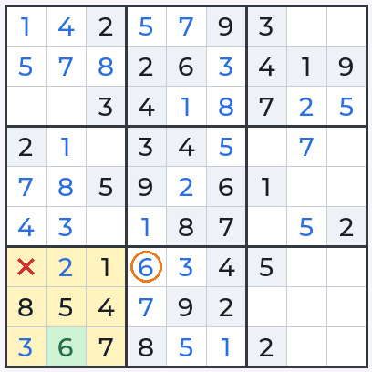

<!-- Written by tools/walkthrough.py anti-knight: edit the script, not this page. -->
# Anti-Knight, step 30: the 6 in box 7

**Step 30 of 49** · [← Step 29](step-29.md) · [All steps](../anti-knight.md#the-whole-puzzle-step-by-step) · [Step 31 →](step-31.md)

Box 7 needs a 6. r7c1: row 7 has one (r7c4). Only **r9c2** is left: **r9c2 = 6**.

**Step 30 of 49** · [← Step 29](step-29.md) · [All steps](../anti-knight.md#the-whole-puzzle-step-by-step) · [Step 31 →](step-31.md)
