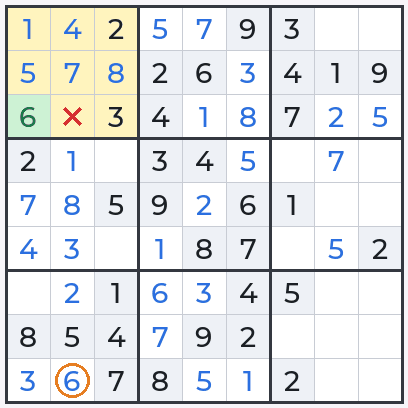

<!-- Written by tools/walkthrough.py anti-knight: edit the script, not this page. -->
# Anti-Knight, step 31: the 6 in box 1

**Step 31 of 49** · [← Step 30](step-30.md) · [All steps](../anti-knight.md#the-whole-puzzle-step-by-step) · [Step 32 →](step-32.md)

Box 1 needs a 6. r3c2: column 2 has one (r9c2). Only **r3c1** is left: **r3c1 = 6**.

**Step 31 of 49** · [← Step 30](step-30.md) · [All steps](../anti-knight.md#the-whole-puzzle-step-by-step) · [Step 32 →](step-32.md)
