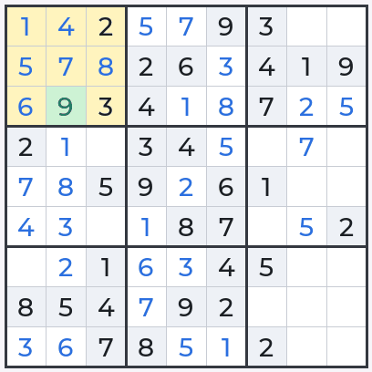

<!-- Written by tools/walkthrough.py anti-knight: edit the script, not this page. -->
# Anti-Knight, step 32: the 9 in box 1

**Step 32 of 49** · [← Step 31](step-31.md) · [All steps](../anti-knight.md#the-whole-puzzle-step-by-step) · [Step 33 →](step-33.md)

Box 1 needs a 9, and r3c2 is its last empty cell: **r3c2 = 9**.

**Step 32 of 49** · [← Step 31](step-31.md) · [All steps](../anti-knight.md#the-whole-puzzle-step-by-step) · [Step 33 →](step-33.md)
