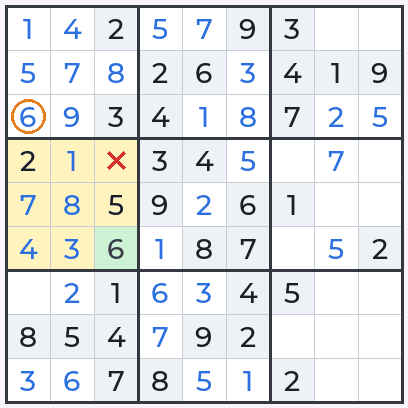

<!-- Written by tools/walkthrough.py anti-knight: edit the script, not this page. -->
# Anti-Knight, step 33: the 6 in box 4

**Step 33 of 49** · [← Step 32](step-32.md) · [All steps](../anti-knight.md#the-whole-puzzle-step-by-step) · [Step 34 →](step-34.md)

Box 4 needs a 6. r4c3: the 6 in r3c1 is a knight's move away. Only **r6c3** is left: **r6c3 = 6**.

**Step 33 of 49** · [← Step 32](step-32.md) · [All steps](../anti-knight.md#the-whole-puzzle-step-by-step) · [Step 34 →](step-34.md)
