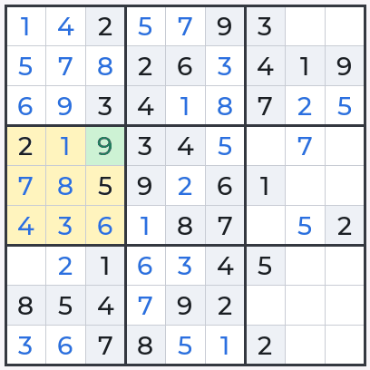

<!-- Written by tools/walkthrough.py anti-knight: edit the script, not this page. -->
# Anti-Knight, step 34: the 9 in box 4

**Step 34 of 49** · [← Step 33](step-33.md) · [All steps](../anti-knight.md#the-whole-puzzle-step-by-step) · [Step 35 →](step-35.md)

Box 4 needs a 9, and r4c3 is its last empty cell: **r4c3 = 9**.

**Step 34 of 49** · [← Step 33](step-33.md) · [All steps](../anti-knight.md#the-whole-puzzle-step-by-step) · [Step 35 →](step-35.md)
