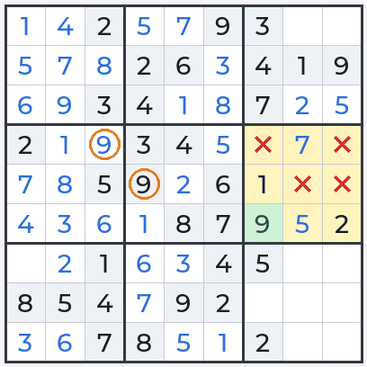

<!-- Written by tools/walkthrough.py anti-knight: edit the script, not this page. -->
# Anti-Knight, step 35: the 9 in box 6

**Step 35 of 49** · [← Step 34](step-34.md) · [All steps](../anti-knight.md#the-whole-puzzle-step-by-step) · [Step 36 →](step-36.md)

Box 6 needs a 9. r4c7 and r4c9: row 4 has one (r4c3). r5c8 and r5c9: row 5 has one (r5c4). Only **r6c7** is left: **r6c7 = 9**.

**Step 35 of 49** · [← Step 34](step-34.md) · [All steps](../anti-knight.md#the-whole-puzzle-step-by-step) · [Step 36 →](step-36.md)
