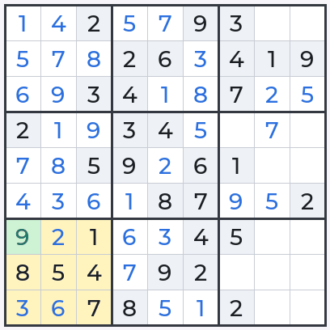

<!-- Written by tools/walkthrough.py anti-knight: edit the script, not this page. -->
# Anti-Knight, step 36: the 9 in box 7

**Step 36 of 49** · [← Step 35](step-35.md) · [All steps](../anti-knight.md#the-whole-puzzle-step-by-step) · [Step 37 →](step-37.md)

Box 7 needs a 9, and r7c1 is its last empty cell: **r7c1 = 9**.

**Step 36 of 49** · [← Step 35](step-35.md) · [All steps](../anti-knight.md#the-whole-puzzle-step-by-step) · [Step 37 →](step-37.md)
