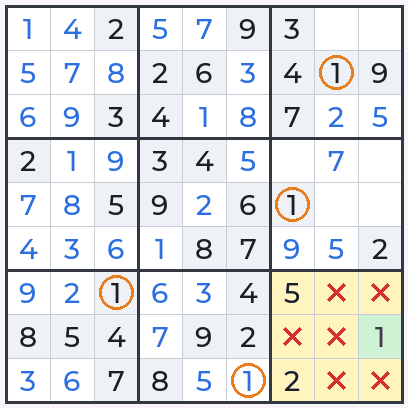

<!-- Written by tools/walkthrough.py anti-knight: edit the script, not this page. -->
# Anti-Knight, step 37: the 1 in box 9

**Step 37 of 49** · [← Step 36](step-36.md) · [All steps](../anti-knight.md#the-whole-puzzle-step-by-step) · [Step 38 →](step-38.md)

Box 9 needs a 1. r7c8 and r7c9: row 7 has one (r7c3). r8c7: column 7 has one (r5c7). r8c8: column 8 has one (r2c8). r9c8 and r9c9: row 9 has one (r9c6). Only **r8c9** is left: **r8c9 = 1**.

**Step 37 of 49** · [← Step 36](step-36.md) · [All steps](../anti-knight.md#the-whole-puzzle-step-by-step) · [Step 38 →](step-38.md)
