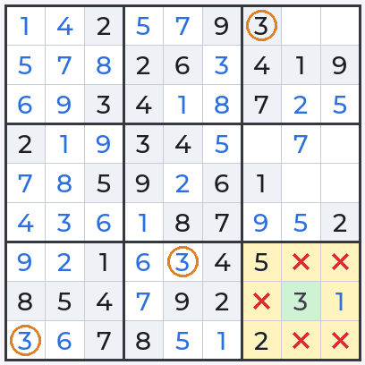

<!-- Written by tools/walkthrough.py anti-knight: edit the script, not this page. -->
# Anti-Knight, step 38: the 3 in box 9

**Step 38 of 49** · [← Step 37](step-37.md) · [All steps](../anti-knight.md#the-whole-puzzle-step-by-step) · [Step 39 →](step-39.md)

Box 9 needs a 3. r7c8 and r7c9: row 7 has one (r7c5). r8c7: column 7 has one (r1c7). r9c8 and r9c9: row 9 has one (r9c1). Only **r8c8** is left: **r8c8 = 3**.

**Step 38 of 49** · [← Step 37](step-37.md) · [All steps](../anti-knight.md#the-whole-puzzle-step-by-step) · [Step 39 →](step-39.md)
